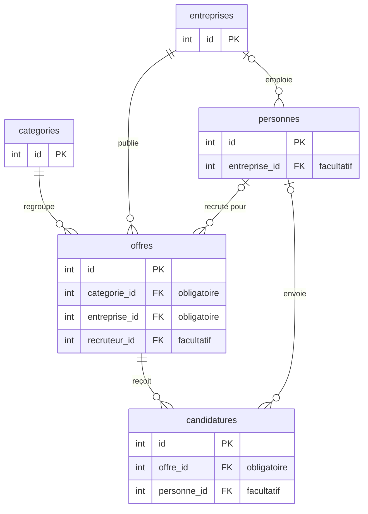

# Base de données du Job Board

La base est un fichier SQLite, `backend/jobboard.db`. Ses tables sont décrites dans [`backend/schema.sql`](../backend/schema.sql) et remplies par [`backend/seed.php`](../backend/seed.php).

## Le diagramme

Seuls les `id` et les clés étrangères sont dessinés. La liste complète des colonnes est dans le [README](../README.md#base-de-données).

Comment le lire : `categories ||--o{ offres` veut dire qu'une catégorie regroupe zéro, une ou plusieurs offres, et qu'une offre a exactement une catégorie. Avec `|o` à gauche, le lien est facultatif : une personne peut n'avoir aucune entreprise.

## Les liens, un par un

| Colonne | Pointe vers | Obligatoire | Ce que ça veut dire |
|---|---|---|---|
| `offres.categorie_id` | `categories` | Oui | Chaque offre a une catégorie. |
| `offres.entreprise_id` | `entreprises` | Oui | Chaque offre appartient à une entreprise. |
| `offres.recruteur_id` | `personnes` | Non | La personne qui gère l'offre, si on la connaît. |
| `personnes.entreprise_id` | `entreprises` | Non | Rempli pour un recruteur, vide pour un candidat ou un admin. |
| `candidatures.offre_id` | `offres` | Oui | L'offre à laquelle on postule. |
| `candidatures.personne_id` | `personnes` | Non | Le compte du candidat, s'il était connecté. |

## Les règles de suppression

Elles sont écrites dans le schéma, avec `ON DELETE`. C'est donc la base qui les applique, pas le code PHP.

| On supprime… | Règle | Conséquence |
|---|---|---|
| une entreprise | `CASCADE` sur ses offres, `SET NULL` sur ses personnes | Ses offres et leurs candidatures sont supprimées. Ses recruteurs gardent leur compte, sans entreprise. |
| une offre | `CASCADE` sur ses candidatures | Ses candidatures sont supprimées. |
| une personne | `SET NULL` sur ses offres et ses candidatures | Elles restent, sans lien vers elle. |
| une catégorie | Aucune règle | Refusé tant que des offres l'utilisent : l'API répond 409. |

Ces règles ne fonctionnent que si les clés étrangères sont activées. C'est fait à chaque connexion, dans [`backend/database.php`](../backend/database.php), avec `PRAGMA foreign_keys = ON`.

## Les choix

- **Une seule table `personnes`** pour les admins, les recruteurs et les candidats, distingués par la colonne `role`. Trois tables auraient répété les mêmes colonnes.
- **Les coordonnées du candidat sont copiées dans la candidature** (nom, prénom, e-mail, téléphone). Une personne sans compte peut ainsi postuler, et la candidature reste lisible même si le compte est supprimé.
- **Deux descriptions par offre** : `description_courte`, obligatoire, pour la liste, et `description`, facultative, pour « En savoir plus ».
- **Le salaire tient en deux nombres**, `salaire_min` et `salaire_max` : identiques pour un salaire fixe, vides s'il n'est pas précisé.
- **L'e-mail d'une personne est unique** : la base refuse un doublon.
- **Les mots de passe sont hachés** avec `password_hash()`, jamais stockés en clair.
- **Les dates se remplissent toutes seules** à la création, avec la date du jour.

## Recréer la base

Après une modification de `schema.sql` : supprimer `backend/jobboard.db`, puis lancer `php scripts/init-db.php` depuis la racine du dépôt (voir le [README](../README.md#installation-et-lancement)). Le script recrée les tables et remet les données de test.

Pour seulement remettre les données de test : `php seed.php`, depuis `backend/`. Attention, il efface d'abord tout ce que la base contient.
